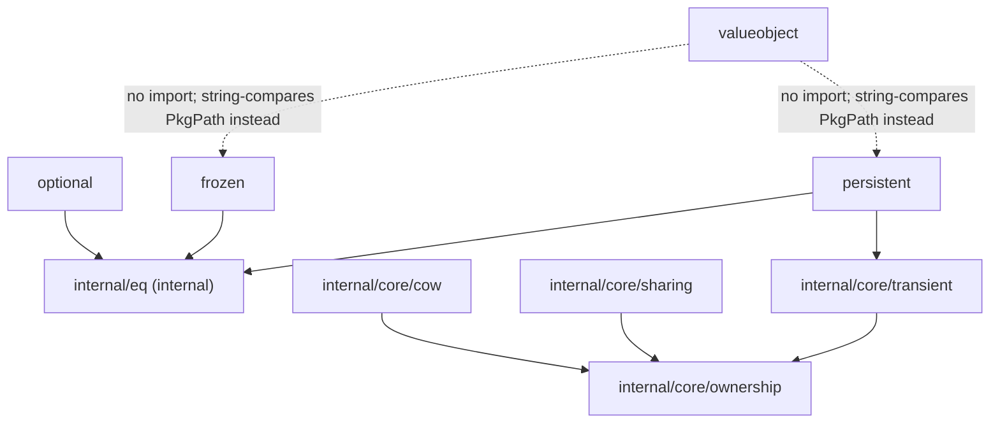

# functional module overview

High-level purpose, the language constraint that shapes the whole API, the
internal immutability core, and the dependency rules that keep this module
small and auditable. For package-level API detail see [packages/](packages/);
for runnable sketches see [examples.md](examples.md).

---

## What it is

`github.com/alvadorncorp/gopackages/functional` is an umbrella module for
small, general-purpose functional-programming building blocks with **zero
dependencies outside the standard library, permanently**:

- **`optional`** — `Optional[T]`, a value type for an operation that may or
  may not produce a `T`. Explicit absence, not a nil check.
- **`frozen`** — `Slice[T]` and `Map[K,V]`, read-only snapshots that copy on
  every boundary crossing. No write operation exists, or ever will.
- **`persistent`** — `List[T]`, `Map[K,V]`, `Set[T]`: collections that write
  functionally (every update returns a new value). Today's engines full-copy
  a stdlib slice or map; Builders use the internal transient window for a
  linear build path.
- **`valueobject`** — `Check[T]`, a reflective test helper that verifies a
  type is structurally immutable.

## Why the root package is doc-only

`functional` itself (the root package, [`doc.go`](../doc.go)) exports
nothing. That is deliberate, not an oversight: the four concepts above do not
share a common supertype, a common constructor, or any runtime behavior — the
only thing they share is "small, dependency-free, functional in spirit." A
root package that re-exported all four (type aliases, or worse, a grab-bag of
helpers) would give every consumer of any one concept a compile-time
dependency on the other three, defeating the point of splitting them into
subpackages in the first place. So the root package carries only the
module-level doc comment, and every concept lives one import path down:
`functional/optional`, `functional/frozen`, `functional/persistent`,
`functional/valueobject`.

## The constraint that shapes the whole API: no type parameters on methods

Go does not allow a method to introduce its own type parameters. The
grammar in `$GOROOT/doc/go_spec.html` is exact about this:

```text
MethodDecl = "func" Receiver MethodName Signature [ FunctionBody ] .
```

There is no `[ TypeParameters ]` production between `MethodName` and
`Signature` — contrast with `FunctionDecl`, which does have one. A method can
use the type parameters bound by its receiver (`Optional[T]`'s `T`), but it
cannot introduce a new one of its own. `Optional[T].Map` cannot exist as a
method returning `Optional[U]` for a `U` chosen at the call site; only a
free, package-level function can bind a second type parameter that way.

This single grammar fact is why `optional`'s type-changing operations —
`Map`, `FlatMap`, `MapErr`, `Zip`, `EqualFunc` — are package-level functions,
never methods, while every operation that keeps the result type `T` —
`IsSome`, `Get`, `OrElse`, `Filter`, `Equal`, and the rest — stays a method.
It is not a style preference; it is the only shape the language permits for
"take an `Optional[T]`, return an `Optional[U]`." See
[ADR-001](adr/functional/adr-001-optional-representation-and-zero-value.md)
for how this interacts with `Optional`'s representation and its `Equal`
method.

## Internal immutability core

Under `functional/internal/core/` lives a thin substrate for exclusive
mutation and batch edit windows. It is **not** a public package and **not**
a shipped HAMT/RRB engine. Core answers only "may I mutate?"; concrete
structures own how they clone. See
[packages/core.md](packages/core.md) and
[ADR-004](adr/functional/adr-004-thin-immutability-core.md).

| Package | Role |
|---|---|
| `ownership` | Pointer-identity `*Owner` token; nil stamp = published |
| `cow` | `NeedsCopy` / `EnsureEditable` — caller supplies clone; no `Clone[T]`, no reflect |
| `sharing` | `Detach` / `Published` — clear exclusive stamps |
| `transient` | `Window` Open / Owner / Freeze (open iff non-nil owner) |

`persistent` Builders already open a `transient.Window` and `Freeze` on
`Build`. List/Map/Set themselves still full-copy on immutable updates.
Documented O(log n) complexity on the public API is **aspirational headroom**
for a future structure-sharing engine, not a claim that core implements one.

## The zero-dependency boundary

`functional` depends on nothing outside the standard library, and this is
not just documented — `internal/archtest` in each module
(`functional/internal/archtest`, mirrored by `faults/internal/archtest`)
proves it mechanically on every test run:

- `TestNoNonStdlibDependencies` runs `go list -deps -json` on every public
  subpackage and fails if any transitive dependency falls outside the
  module's own prefix.
- `TestGoModHasNoRequirements` reads `go.mod` directly and fails if a
  `require` or `replace` line ever appears — catching an accidental `go get`
  at the source, before it needs a stray import to surface.

Additional core gates: `TestCoreNoReflect`, `TestCoreDependencyDAG` (star
into `ownership`), and `TestPublicPackagesDoNotImportCore` (`optional` /
`frozen` / `valueobject` must not import core; `persistent` may).

## No public subpackage imports another (in production code)

`optional`, `frozen`, `persistent`, and `valueobject` do not import each
other **in production code**. This is also proven, not just documented:
`TestNoPublicSiblingDependencies` in `functional/internal/archtest` walks
each public subpackage's dependency list, via `go list -deps -json` without
`-test`, and fails if it contains another public subpackage's import path.

The invariant is scoped to production imports by design. Test code MAY
import a sibling public package to exercise or demonstrate cross-package
behavior — that is a legitimate use of a real dependency between test
binaries, not a violation of the architectural boundary the mechanism above
protects. The concrete example in this module is
`valueobject/check_test.go`, which imports `functional/frozen` directly to
build a `Good` fixture whose one collection field is a `frozen.Slice[string]`
— proving that `AllowPackage`'s default leaf list actually frees `frozen`
fields, not just that the code compiles. `go list -deps -json` without
`-test` never sees that import, because it does not inspect `_test.go`
files; `TestNoPublicSiblingDependencies` would need `-test` to catch it, and
deliberately does not pass it, for exactly this reason.



There is exactly **one** shared exception for equality: `functional/internal/eq`,
a small package that resolves value equality in three tiers (an `Equal(T) bool`
method on the dynamic value, then `==` when the dynamic values are
comparable, then `reflect.DeepEqual`). `optional.Optional[T].Equal`,
`frozen.Slice[T].Equal`, `frozen.Map[K,V].Equal`, and
`persistent.List[T].Equal` (and its `Map`/`Set` counterparts) all delegate to
it, so every generic `Equal` in this module agrees on the answer for the same
pair of values. It is safe as the one shared package specifically *because*
it is `internal`: nothing outside `functional` can import it, so it can never
become a second public surface competing with the rule it is the exception
to. **`eq` is outside core** and may use `reflect`; core may not.

`valueobject` treats `frozen` and `persistent` as immutable leaves by
default (see [patterns/value-objects.md](patterns/value-objects.md)), but it
does this **without importing either**: `AllowPackage`'s default leaf list
compares a candidate field's `reflect.Type.PkgPath()` against the string
`"github.com/alvadorncorp/gopackages/functional/frozen"` (and the
`persistent` equivalent). A string comparison creates no import edge, so
`valueobject` stays sibling-independent while still knowing that a
`frozen.Slice[string]` field needs no further descent.

## Related documents

- [Package API: optional](packages/optional.md)
- [Package API: frozen](packages/frozen.md)
- [Package API: persistent](packages/persistent.md)
- [Package API: valueobject](packages/valueobject.md)
- [Internal: core](packages/core.md)
- [Examples](examples.md)
- [Value object pattern](patterns/value-objects.md)
- [ADR-001 — Optional representation and zero value](adr/functional/adr-001-optional-representation-and-zero-value.md)
- [ADR-003 — Zero-dependency boundary](adr/functional/adr-003-zero-dependency-boundary.md)
- [ADR-004 — Thin immutability core](adr/functional/adr-004-thin-immutability-core.md)
