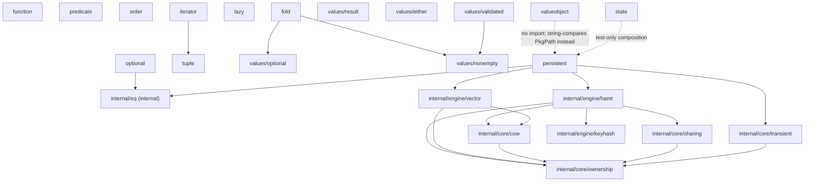

# functional module overview

High-level purpose, the language constraint that shapes the whole API, the
internal immutability core, and the dependency rules that keep this module
small and auditable. For package-level API detail see [packages/](packages/);
for runnable sketches see [examples.md](examples.md).

---

## What it is

`github.com/alvadorncorp/gopackages/functional` is an umbrella module for
small, general-purpose functional-programming building blocks with **zero
dependencies outside the standard library, permanently**:

- **`function`** — six stateless generic combinators for ordinary Go function
  values. It is a standard-library-only public leaf.
- **`predicate`** — Boolean composition, quantifiers, and comparable-derived
  predicates. It is a standard-library-only public leaf with left-to-right
  short-circuiting.
- **`order`** — sign-based total orders, projections, reversal, and
  lexicographic composition. It is a standard-library-only public leaf.
- **`fold`** — iterative left/right folds, typed reductions, and a preallocated
  left scan over slices. It imports exactly `values/optional` and
  `values/nonempty`.
- **[`tuple`](tuple/)** — `Tuple2`/`Tuple3` heterogeneous structural carriers and type-changing component maps; stdlib-only.
- **`lazy`** — concurrent-safe deferred computations that memoize a value or panic; stdlib-only.
- **[`iterator`](iterator/)** — lazy transforms, limits, tuple Zip/Enumerate, folds and searches over native `iter.Seq`; imports only tuple.
- **`optional`** — `Optional[T]`, a value type for an operation that may or
  may not produce a `T`. Explicit absence, not a nil check.
- **`persistent`** — `List[T]`, `Map[K,V]`, `Set[T]`: immutable collections
  that write functionally (every update returns a new value). Engines use
  path-copy structural sharing: Map/Set are a HAMT; List is a 32-way
  persistent vector. Builders open an exclusive transient window and
  `Freeze` in O(1) via owner invalidation. Use the same types for
  read-only snapshots (never call write methods) and for versioned state.
  `persistent` may produce `iter.Seq` values for consumers, but
  `iterator` never imports `persistent`.
- **`state`** — `State[T]`: pure semantic evolution over an opaque `T`.
  `Apply` records reverse-linked plan steps without running them;
  `Materialize` re-applies the full plan (no cache); `Begin`/`Transaction`
  batches plan growth; `DiffBetween` captures structural plan diffs within
  one lineage. Mesh-isolated from `persistent` in production code.
- **`valueobject`** — `Check[T]`, a reflective test helper that verifies a
  type is structurally immutable.
- **`values/optional`**, **`values/result`**, **`values/either`**,
  **`values/nonempty`**, and **`values/validated`** — independent generic
  values for presence, fail-fast outcomes, neutral alternatives, minimum
  cardinality, and accumulating validation. See the
  [functional values family guide](packages/values.md).

## Why the root package is doc-only

`functional` itself (the root package, [`doc.go`](../doc.go)) exports
nothing. That is deliberate, not an oversight: the concepts above do not
share a common supertype, a common constructor, or any runtime behavior — the
only thing they share is "small, dependency-free, functional in spirit." A
root package that re-exported all of them (type aliases, or worse, a grab-bag of
helpers) would give every consumer of any one concept a compile-time
dependency on the others, defeating the point of splitting them into
subpackages in the first place. So the root package carries only the
module-level doc comment, and every concept lives one import path down:
`functional/function`, `functional/predicate`, `functional/order`,
`functional/fold`, `functional/tuple`, `functional/lazy`, `functional/iterator`,
`functional/optional`, `functional/persistent`, `functional/state`,
`functional/valueobject`, or one of the five
`functional/values/*` packages.

`functional/optional` remains the established legacy API and is supported
unchanged. `functional/values/optional` is an independent, smaller baseline
type: this module deliberately provides no alias, conversion, or migration
between the two.

## The constraint that shapes the whole API: no type parameters on methods

Go does not allow a method to introduce its own type parameters. The
grammar in `$GOROOT/doc/go_spec.html` is exact about this:

```text
MethodDecl = "func" Receiver MethodName Signature [ FunctionBody ] .
```

There is no `[ TypeParameters ]` production between `MethodName` and
`Signature` — contrast with `FunctionDecl`, which does have one. A method can
use the type parameters bound by its receiver (`Optional[T]`'s `T`), but it
cannot introduce a new one of its own. `Optional[T].Map` cannot exist as a
method returning `Optional[U]` for a `U` chosen at the call site; only a
free, package-level function can bind a second type parameter that way.

This single grammar fact is why `optional`'s type-changing operations —
`Map`, `FlatMap`, `MapErr`, `Zip`, `EqualFunc` — are package-level functions,
never methods, while every operation that keeps the result type `T` —
`IsSome`, `Get`, `OrElse`, `Filter`, `Equal`, and the rest — stays a method.
It is not a style preference; it is the only shape the language permits for
"take an `Optional[T]`, return an `Optional[U]`." See
[ADR-001](adr/functional/adr-001-optional-representation-and-zero-value.md)
for how this interacts with `Optional`'s representation and its `Equal`
method.

## Internal immutability core vs engines

Under `functional/internal/core/` lives a thin substrate for exclusive
mutation and batch edit windows. It is **not** a public package and **not**
an engine. Core answers only "may I mutate?"; concrete engines own how they
clone and share structure. See
[packages/core.md](packages/core.md) and
[ADR-004](adr/functional/adr-004-thin-immutability-core.md).

| Package | Role |
|---|---|
| `ownership` | Pointer-identity `*Owner` token with `Active` / `Invalidate`; nil stamp = published |
| `cow` | `NeedsCopy` / `EnsureEditable` — caller supplies clone; no `Clone[T]`, no reflect |
| `sharing` | `Detach` / `Published` — clear exclusive stamps |
| `transient` | `Window` Open / Owner / Freeze (Freeze is O(1) owner invalidation) |

Engines live under `functional/internal/engine/` (also internal):

| Engine | Used by | Representation |
|---|---|---|
| `hamt` | `persistent.Map`, `persistent.Set` | 32-way HAMT; path-copy structural sharing; per-`Root` `maphash.Seed` via `maphash.Comparable` |
| `vector` | `persistent.List` | 32-way persistent vector (trie + tail); path-copy on Set/Append/Pop (Pop O(1)/O(log n) internal); mid-index `Delete` O(n) |

`persistent` Builders open a `transient.Window`, edit under the window's
exclusive owner (engine transient paths mutate owned nodes in place), and
`Freeze` on `Build` — O(1) publish by invalidating the owner token; no tree
walk. Documented complexity bounds on the public API are upper-bound
headroom; see [ADR-005](adr/functional/adr-005-persistent-engine-family.md).

`state` does **not** use core or engines. Its plan is a reverse-linked list
of pure `func(T) T` steps owned entirely by the `state` package.

## The zero-dependency boundary

`functional` depends on nothing outside the standard library, and this is
not just documented — `internal/archtest` in each module
(`functional/internal/archtest`, mirrored by `faults/internal/archtest`)
proves it mechanically on every test run:

- `TestNoNonStdlibDependencies` runs `go list -deps -json` on every public
  subpackage and fails if any transitive dependency falls outside the
  module's own prefix.
- `TestGoModHasNoRequirements` reads `go.mod` directly and fails if a
  `require` or `replace` line ever appears — catching an accidental `go get`
  at the source, before it needs a stray import to surface.

Additional core gates: `TestCoreNoReflect`, `TestCoreDependencyDAG` (star
into `ownership`), and `TestPublicPackagesDoNotImportCore` (`optional` /
`valueobject` / `state` must not import core; `persistent` may).

## No public subpackage imports another (in production code)

`function`, `predicate`, `order`, `fold`, `tuple`, `lazy`, `iterator`, `optional`,
`persistent`, `state`, and `valueobject` do not import each other **in production
code**, except for the explicitly allowed sibling edges. This is also proven, not
just documented: `TestPublicDependencyDAG` in `functional/internal/archtest`
walks each public subpackage's dependency list, via `go list -deps -json`
without `-test`, and fails if it contains another public subpackage's import
path except the explicitly allowed edges: `values/validated` → `values/nonempty`,
`fold` → `values/optional`, `fold` → `values/nonempty`, and
`iterator` → `tuple`.

The invariant is scoped to production imports by design. Test code MAY
import a sibling public package to exercise or demonstrate cross-package
behavior — that is a legitimate use of a real dependency between test
binaries, not a violation of the architectural boundary the mechanism above
protects. Concrete examples in this module:

- `valueobject/check_test.go` imports `functional/persistent` to build a
  `Good` fixture whose one collection field is a `persistent.List[string]`
  — proving that `AllowPackage`'s default leaf list actually frees
  `persistent` fields, not just that the code compiles.
- `state` integration and bench tests may import `functional/persistent`
  when `T` embeds Map/Set/List fields; production `state` still has no
  sibling edge.

`go list -deps -json` without `-test` never sees those imports, because it
does not inspect `_test.go` files; `TestPublicDependencyDAG` would need
`-test` to catch them, and deliberately does not pass it, for exactly this
reason.

### Values-family production gates

The five values packages (`values/optional`, `values/result`,
`values/either`, `values/nonempty`, and `values/validated`) have a stricter,
family-local production boundary. `TestValuesDependencyDAG` permits exactly
one in-module edge — `values/validated` → `values/nonempty` — leaving the
other four packages as standard-library-only leaves. In the same
`functional/internal/archtest` package, `TestValuesNoReflectOrUnsafe` reads
only production imports (never `_test.go` imports) and rejects direct
`reflect` or `unsafe` imports for all five values packages. Together with
`TestPublicDependencyDAG`, these are executable constraints rather than
conventions.

### Primitive production gates

`function`, `predicate`, `order`, `tuple`, and `lazy` are standard-library-only leaves.
`fold` imports exactly `values/optional` and `values/nonempty`. `iterator`
imports exactly `tuple`. `TestPrimitiveDependencyDAG` and
`TestPrimitivesNoReflectOrUnsafe` enforce this production DAG and reject
`reflect` or `unsafe` in every primitive. `persistent` may produce `iter.Seq`
values, but `iterator` never imports `persistent`.



`state` has **no production edges** to siblings or to core/engine. The
dashed `state` → `persistent` edge is test-only composition (optional in
diagrams; never a production import).

### Distinctions: state vs persistent vs domain

```
state.Transaction ≠ persistent.Builder
state.Diff ≠ Domain Event
state.Version ≠ DB revision
state.Materialize ≠ deep clone
```

See [packages/state.md](packages/state.md) for the full contract.

There is exactly **one** shared exception for equality: `functional/internal/eq`,
a small package that resolves value equality without `reflect` (an `Equal(T) bool`
method on the dynamic value, then `==` when the dynamic values are
comparable; non-comparable types without `Equal` return false — never
deep-compare). `optional.Optional[T].Equal` and `persistent.List[T].Equal` (and its
`Map`/`Set` counterparts) all delegate to it, so every generic `Equal` in
this module agrees on the answer for the same pair of values. Callers that
need structural equality for slices or maps should use an `Equal` method on
the element type or an `EqualFunc` at their package. It is safe as the one
shared package specifically *because* it is `internal`: nothing outside
`functional` can import it, so it can never become a second public surface
competing with the rule it is the exception to. **`eq` is outside core**
and, like core, must not use `reflect`.

`valueobject` treats `persistent` as an immutable leaf by default (see
[patterns/value-objects.md](patterns/value-objects.md)), but it does this
**without importing it**: the default leaf list compares a candidate field's
`reflect.Type.PkgPath()` against the string
`"github.com/alvadorncorp/gopackages/functional/persistent"`. A string
comparison creates no import edge, so `valueobject` stays sibling-independent
while still knowing that a `persistent.List[string]` field needs no further
descent.

## Related documents

- [Package API: function](packages/function.md)
- [Package API: predicate](packages/predicate.md)
- [Package API: order](packages/order.md)
- [Package API: fold](packages/fold.md)
- [Package API: tuple](packages/tuple.md)
- [Package API: lazy](packages/lazy.md)
- [Package API: iterator](packages/iterator.md)
- [Package API: optional](packages/optional.md)
- [Package API: persistent](packages/persistent.md)
- [Package API: state](packages/state.md)
- [Package API: valueobject](packages/valueobject.md)
- [Internal: core](packages/core.md)
- [Functional values family](packages/values.md)
- [Package API: values Optional](packages/values-optional.md)
- [Package API: values Result](packages/values-result.md)
- [Package API: values Either](packages/values-either.md)
- [Package API: values NonEmpty](packages/values-nonempty.md)
- [Package API: values Validated](packages/values-validated.md)
- [Examples](examples.md)
- [Value object pattern](patterns/value-objects.md)
- [ADR-001 — Optional representation and zero value](adr/functional/adr-001-optional-representation-and-zero-value.md)
- [ADR-003 — Zero-dependency boundary](adr/functional/adr-003-zero-dependency-boundary.md)
- [ADR-004 — Thin immutability core](adr/functional/adr-004-thin-immutability-core.md)
- [ADR-005 — Persistent engine family (HAMT + vector)](adr/functional/adr-005-persistent-engine-family.md)
- [ADR-006 — State semantic layer](adr/functional/adr-006-state-semantic-layer.md)
- [ADR-007 — Values family dependency boundary](adr/functional/adr-007-values-family-dependency-boundary.md)
- [ADR-008 — Functional primitives and fold dependency boundary](adr/functional/adr-008-functional-primitives-and-fold-boundary.md)
- [ADR-009 — Tuplas, lazy, iteradores e optics sobre contratos nativos de Go](adr/functional/adr-009-structural-primitives-and-iterator-boundary.md)
