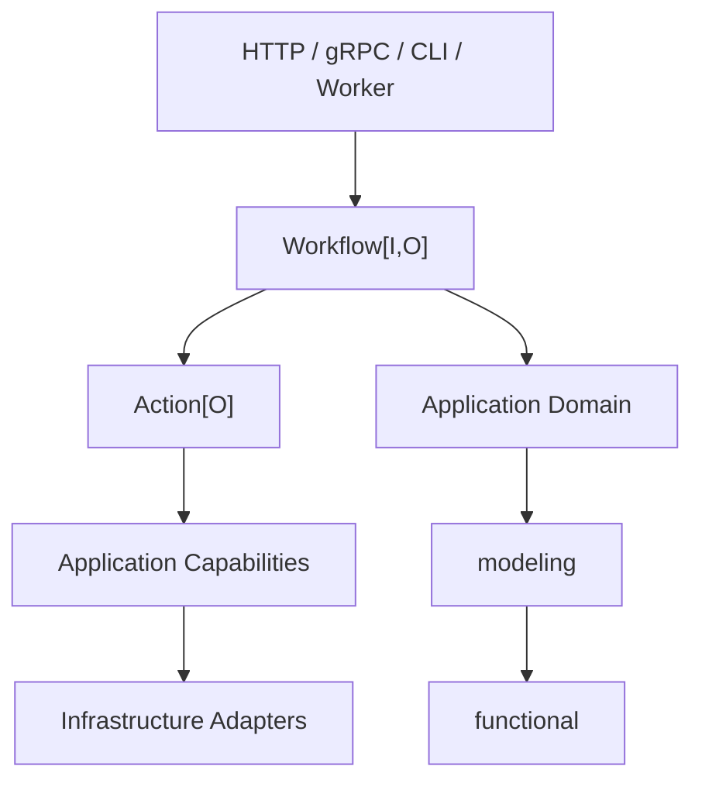

# Architecture



Actual calls happen only after `action.Run(ctx, program)`. Every arrow above
describes a reference, not an invocation.

## Module topology

```text
                application
              /      |      \
             ▼       ▼       ▼
       functional modeling workflow
```

`workflow` and `modeling` are siblings, not a stack: the application is the
layer that composes them. The core of `workflow` depends only on the standard
library.

## Functional core, effectful shell

```text
             FUNCTIONAL CORE
                  domain
                    │
                    ▼
                 modeling
                    │
                    ▼
                 Decision
────────────────────────────────────
             EFFECTFUL SHELL
                 workflow
                    │
              capabilities
                    │
                  adapters
```

The goal is to make the boundary between describing a computation and running
it explicit, not to make I/O pure.

## Boundary test

For any proposed abstraction, ask in order: would it still make sense if
PostgreSQL were replaced? If not, it is an adapter. Would it still make sense
if the Banking domain were replaced entirely? If not, it belongs to the
application. Would it still make sense without effects, context, and
lifecycle? If so, it belongs in `functional` or `modeling`. Only something
that is specifically composition plus effectful execution is a candidate for
`workflow`.

## Lifecycle without a runtime

`Bracket` knows only `Action[R]`, `R → Action[T]`, and
`R → Action[struct{}]`. It knows nothing about pools, locks, leases, tracing,
or databases. `Zip`, `Both`, and `Traverse` create no goroutines; `Ensure` and
`Bracket` recover no panics and shield no cancellation. The dependency DAG
stays `workflow -> action <- transaction`, with `plan` as a stdlib-only leaf
and `resilience -> action`. The core's closure stays stdlib-only.

## Resilience without preemption

`workflow/resilience` transforms `action.Action` lazily and synchronously. It
is the one architectural exception for `time` and `context.WithTimeout`.
Timeout is cooperative: it derives a child context and calls the source on the
same goroutine; an Action that ignores its context is never interrupted by
preemption.
