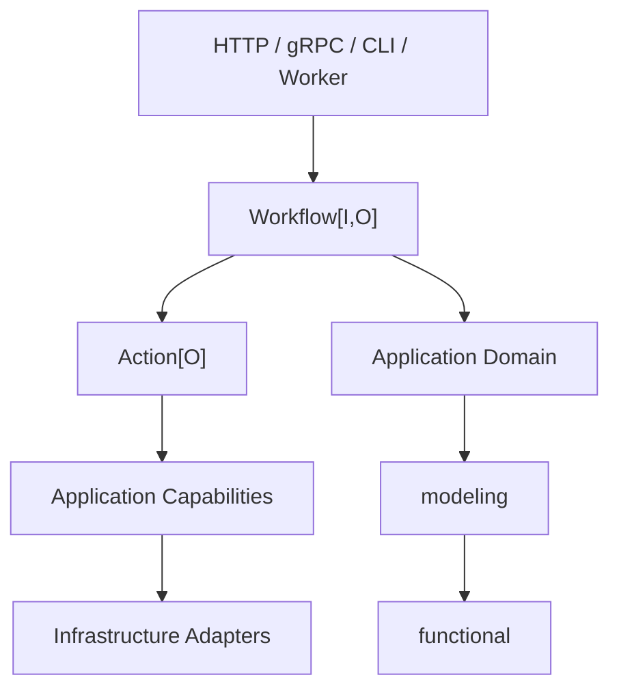

# Arquitetura



Chamadas efetivas acontecem somente após `action.Run(ctx, program)`. Toda seta
acima descreve uma referência, não uma invocação.

## Topologia dos módulos

```text
                application
              /      |      \
             ▼       ▼       ▼
       functional modeling workflow
```

`workflow` e `modeling` são irmãos, não uma pilha: a aplicação é a camada que os
compõe. O núcleo de `workflow` depende apenas da biblioteca padrão.

## Núcleo funcional, casca com efeitos

```text
             FUNCTIONAL CORE
                  domain
                    │
                    ▼
                 modeling
                    │
                    ▼
                 Decision
────────────────────────────────────
             EFFECTFUL SHELL
                 workflow
                    │
              capabilities
                    │
                  adapters
```

O objetivo não é tornar I/O puro. É tornar explícita a fronteira entre descrever
uma computação e executá-la.

## Teste de fronteira

Para qualquer abstração proposta, pergunte em ordem: ainda faria sentido se o
PostgreSQL fosse substituído? Se não, é um adaptador. Ainda faria sentido se o
domínio Banking fosse substituído por completo? Se não, pertence à aplicação.
Ainda faria sentido sem efeitos, contexto e ciclo de vida? Se sim, pertence a
`functional` ou `modeling`. Somente algo que seja especificamente composição mais
execução com efeitos é candidato a `workflow`.
