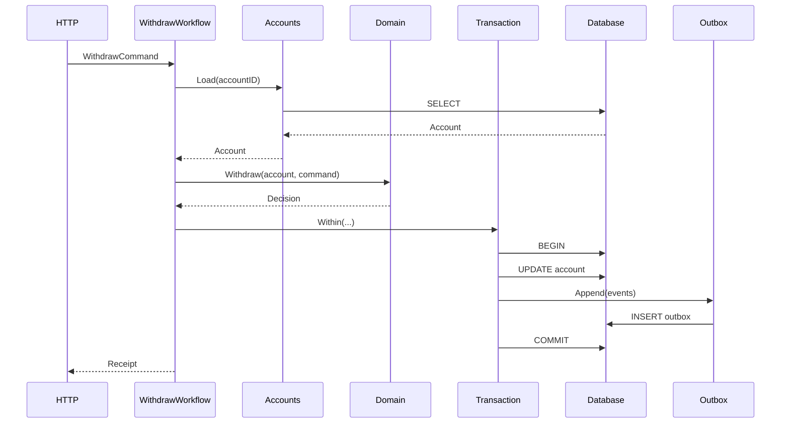
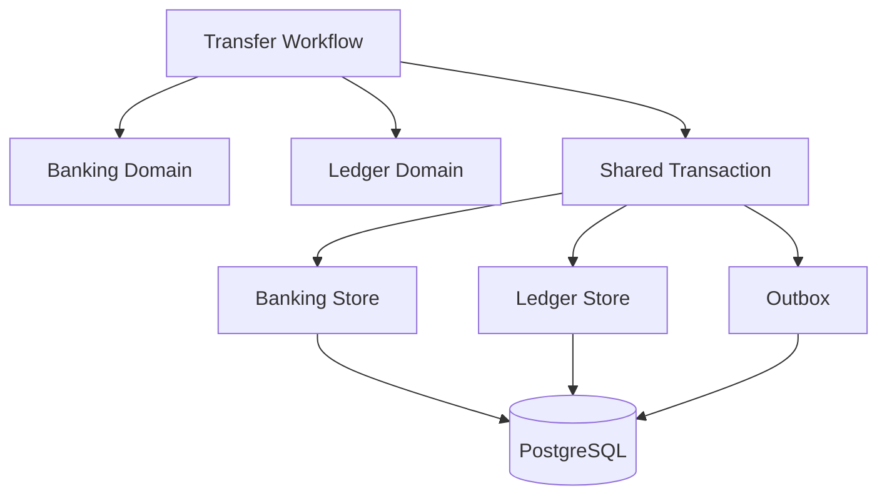
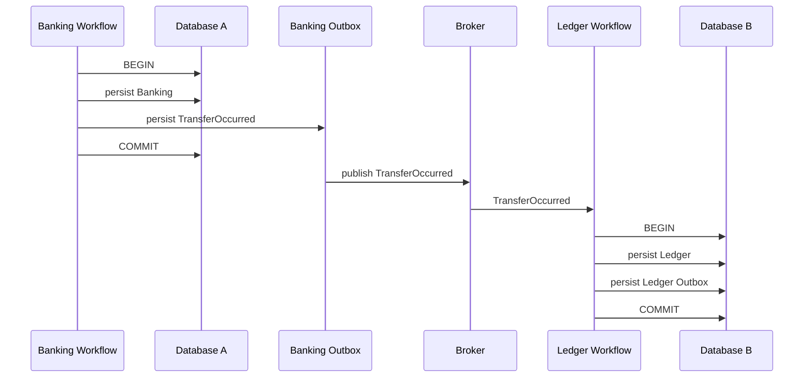

# Exemplos

Os exemplos vivem em um módulo separado, `workflow/examples`, porque consomem
`modeling` e PostgreSQL enquanto o núcleo garante um fecho de dependências
apenas stdlib. São testes de aceitação de arquitetura: se uma mudança de API os
torna desajeitados, a API é o que deve ser reconsiderada.

## withdraw

`POST /accounts/{id}/withdraw` de ponta a ponta.



Chamadas efetivas começam somente após `action.Run(ctx, program)`. Entre
construir o comando e chamar `Run`, zero efeitos ocorrem — um teste afirma isso
com um contador.

Uma recusa de domínio, como saldo insuficiente, retorna antes de qualquer
`BEGIN`. Uma falha ao escrever o outbox reverte a atualização da conta, de modo
que as duas nunca divergem.

## crosscontext, cenário A: um resource manager



Banking e Ledger mantêm modelos e regras independentes. Eles por acaso
compartilham um banco, então uma transação ACID cobre ambos mais o outbox. Dois
bounded contexts não são duas fronteiras de transação — esses são conceitos
diferentes.

## crosscontext, cenário B: resource managers independentes



Nenhuma transação ACID abrange A, o broker e B. Cada lado é localmente atômico e
o sistema converge depois: consistência eventual, não atomicidade global. A
entrega é at-least-once, então o workflow do Ledger consulta um inbox antes de
aplicar uma mensagem — e esse inbox é uma capacidade da aplicação, não algo que
este módulo forneça.

## Transfer: composição explícita das novas operações

Um endpoint recebe `TransferRequest`, adapta um workflow de usuário e combina
lookups independentes sem paralelismo:

```go
loadUser := workflow.From(users.Find)
loadRequestUser := workflow.Contramap(
    loadUser,
    func(req TransferRequest) UserID { return req.UserID },
)
userAction := workflow.Provide(loadRequestUser, request)

authorization := action.Both(
    userAction,
    accounts.Find(request.FromAccount),
    func(user User, account Account) AuthorizationInput {
        return AuthorizationInput{User: user, Account: account}
    },
)

accountsPair := action.Zip(
    accounts.Find(request.FromAccount),
    accounts.Find(request.ToAccount),
)
```

`Both` e `Zip` executam esquerda → direita. Para auditar somente depois de
persistência bem-sucedida, `Tap` preserva o resultado:

```go
audited := action.Tap(transfers.Save(transfer), func(saved Transfer) action.Action[struct{}] {
    return audit.Record(AuditEntry{TransferID: saved.ID})
})
```

Best effort continua política explícita da aplicação:

```go
attemptedAudit := action.Attempt(audit.Record(entry))
```

O caller inspeciona `AttemptResult.Err`; a biblioteca não ignora nada. Para um
lease concreto fornecido pelo adapter:

```go
program := action.Bracket(
    leases.Acquire(resourceID),
    func(lease Lease) action.Action[Result] { return perform(lease) },
    func(lease Lease) action.Action[struct{}] { return leases.Release(lease) },
)
```

`AcquireUseRelease` é a forma descritiva do mesmo algoritmo. Release recebe o
mesmo contexto de `Run`, inclusive cancelado, e ocorre após todo retorno normal
de use. Panic continua panic e não promete release. Quando a operação já existe
e precisa apenas de finalização independente do valor, use `Ensure`; quando há
begin/commit/rollback e atomicidade, use `transaction.Within`, não `Bracket`.

Nenhuma dessas composições executa antes de:

```go
result, err := action.Run(ctx, program)
```
